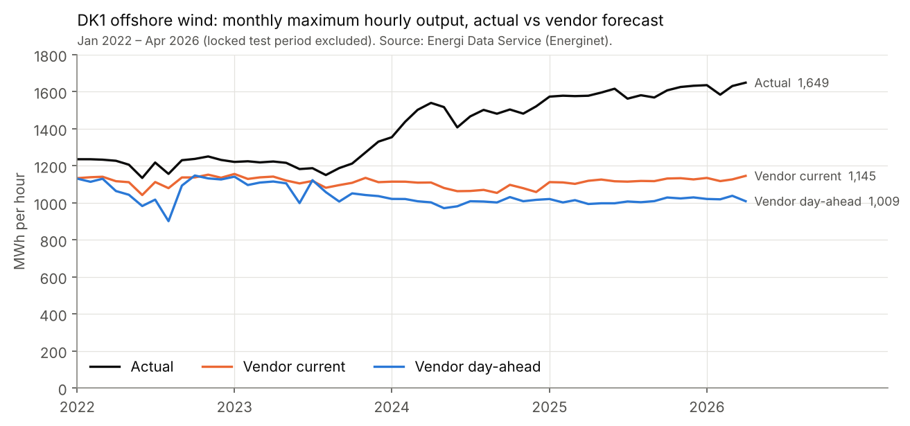

# DK1 day-ahead wind power forecasting

Probabilistic day-ahead forecasts (9 quantiles) of total wind output in Danish price area DK1. They are built on top of
the system operator's public vendor forecast and judged against that vendor on a test period that was scored once.

**Result in one line.** On the locked test period (May–Oct 2026) the final model is **worse** than the vendor: CRPS
+5.4% against the raw vendor baseline and +10.4% against the capacity-corrected vendor. On validation it was 10.3% better.
The simplest fix, rescaling the vendor's offshore forecast for missing capacity, did best on test. Below are the
findings, the protocol, and why the validation gain did not carry over.

## Headline: locked test period

Delivery days 2026-05-01 → 2026-10-28, 4,294 scored hours (51 dropped by the common data mask, the same for all
three). Each model was refit once on 2022-01-01 → 2026-04-30. Units are MWh (hourly energy); bias = mean(P50 − actual).
Source: [`notebooks/05_final_test.ipynb`](notebooks/05_final_test.ipynb).

| Test period | CRPS | vs raw vendor | P50 MAE | P10–P90 coverage (target 0.80) | Bias | Diebold–Mariano |
|---|---|---|---|---|---|---|
| Raw vendor + error quantiles (`002`) | 121.9 | — | 312.4 | 0.708 | −172 | — |
| Capacity-corrected vendor + error quantiles (`003`) | **116.4** | −4.5% | **294.8** | 0.737 | +109 | vs 002: p = 0.24 |
| Final model: LightGBM + CQR (`007`) | 128.5 | +5.4% | 344.1 | 0.762 | −164 | vs 002: stat +1.93, p = 0.055; vs 003: stat +2.39, p = 0.018 |

CRPS is the mean pinball loss over τ = 0.1…0.9. DM is HLN-corrected, on 179 daily mean losses, and a positive
statistic means the first model is worse. **Validation** (4 folds, May 2025 – Apr 2026): CRPS 119.2 (002), 120.7
(003, +1.3%), 106.9 (007, −10.3%).

What this says:

- **The model's validation gain reversed on test.** It lost to the raw vendor in May and July–September
  (+3% to +23% by month) and won in June (−2%) and October (−14%). The errors sit in high-output hours: in the top
  quintile of its P50, coverage is 0.63 and the mean residual is −377 MWh. Likely cause, supported by a post-hoc
  diagnostic but not proven (notebook 05 §6): offshore output rose above the training range, and a tree model does
  not extrapolate beyond it, while the linear capacity rescaling does. In 19.5% of test hours the corrected offshore
  forecast is above its training maximum. On those hours the final model's CRPS is 21% worse than the raw vendor.
  On the other hours it is level with the raw vendor (−0.3%), though still 4.3% worse than step 1. The validation
  folds contain no comparable capacity step, so the loop could not detect this.
- **The capacity correction (step 1).** As a point forecast it removes the vendor's test-period DA bias (−460 →
  +2 MWh) and cuts DA MAE by 41% (537 → 316 MWh). In the probabilistic baseline it cut CRPS by 4.5% on test, but
  the difference is not significant. On validation it made CRPS slightly worse than the raw vendor on all 4 folds
  (+1.3% mean) and also made P50 MAE slightly worse (303.0 vs 299.6 MWh). Its P50 over-forecasts on test
  (+109 MWh), probably because the 90-day error offsets carry over the previous season's bias
  ([notebook 02](notebooks/02_baselines_and_capacity_fix.ipynb), untested hypothesis).
- The final model is the only one with coverage inside 0.76–0.84 on test, but its quantiles are centred too low
  (40% of actuals fall below its P50).

## Finding 1: the vendor forecast does not cover new offshore capacity



From 2024 onwards actual offshore peaks rise to 1,500–1,650 MWh (to April 2026). The vendor's offshore forecasts,
both day-ahead and its latest `ForecastCurrent`, stay capped near 1,000–1,150 MWh, so new capacity is missing from
the vendor model. Over the same period the vendor's day-ahead total bias grows from −12 MWh (2022) to −436 MWh
(Jan–Apr 2026). The offshore gap is not the whole story: in 2024–2026 the **onshore** bias makes up roughly 40–55%
of the total, and its cause is not diagnosed here
([notebook 01](notebooks/01_data_and_vendor_diagnosis.ipynb)). On the test period the raw DA total bias is −460 MWh.

## Finding 2: the vendor's day-ahead forecast is issued per Danish local day

The vendor DA series jumps where one issue ends and the next begins. That happens at **local** midnight (median
step 125–190 MWh vs 50–65 MWh at other hours), at 23:00 UTC in winter and at 22:00 UTC in summer. So every "day" in
this project is a Danish local delivery day (23 or 25 hours on DST change days). With UTC days, the last 1–2 hours
of each day would come from a vendor forecast issued after the forecast's own issue time: a look-ahead leak.

## Method and leakage controls

- **Setting.** Issue time D−1 10:00 UTC for all hours of local day D. Inputs: vendor `ForecastDayAhead` for D;
  actuals and `ForecastCurrent` up to 09:00 UTC on D−1; calendar. Vendor intraday and `ForecastCurrent` for day D
  are never features.
- **Leakage check.** Every feature has an as-of timestamp. `windfc.cutoff.check_features` raises if any feature
  uses data from after the issue time, and every run goes through it (tested).
- **Models.** Step 1 scales the vendor offshore DA by the trailing 30-day actual / `ForecastCurrent` offshore
  ratio. The baselines add 90-day empirical error quantiles to a vendor anchor. The final model is LightGBM
  quantile regression on the corrected vendor forecasts, ramps, calendar and 7-day vendor error statistics, with
  365-day recency weighting and conformal calibration (CQR, 90-day window).
- **Frozen evaluation.** `evaluate.py` (metrics, folds, DM) and `cutoff.py` were committed at `1b685ed` before run
  001. The runner refuses to run if they differ, and the acceptance rule `decide()` was fixed before run 001
  (`d61f8b5`). All models are scored on the same hours.
- **Locked test.** The runner rejects configs and hours on or after 2026-05-01. Notebooks 01–04 read only earlier
  delivery days. The test period was scored once, by `windfc.final.score_test` in notebook 05. No model,
  config or code was changed after the results were seen.

## Optimization log

[`experiments/log.csv`](experiments/log.csv) holds 12 runs: 3 baselines, `004_linear_qr` as initial best, then 2
accepted changes (006: LightGBM + CQR; 007: 365-day recency weighting) and 6 rejections (005 for under-coverage;
008–012). An acceptance needed ≥1% lower mean CRPS, a gain on ≥3 of 4 folds, P50 MAE no more than 1% worse, and
coverage in 0.76–0.84. Five rejections in a row triggered the pre-declared stop rule, after 7 of 15 allowed loop runs.
**Not tried:** LightGBM `num_leaves`, `learning_rate`, `n_estimators`, `feature_fraction`; features
`err_mean_14d`, `err_mae_14d`, `err_mae_30d`, `level_x_hour`, `off_share`; other half-lives and CQR windows;
recency weighting or CQR on linear QR. These were not shown to be useless. Each row's `git_hash` is the commit
checked out when the run started. The run's config is added in the commit that records its row.
Details: [notebook 04](notebooks/04_optimization_log.ipynb).

## Limitations

- No weather (NWP) data: the model can only re-weight and re-calibrate the vendor forecast.
- The vendor DA publication time is assumed to be before 10:00 UTC on D−1. The data has no publication timestamp.
- Step 1 lags capacity step-ups by up to its 30-day window.
- Single price area (DK1).
- Fold-level coverage of the final model on validation was 0.751 and 0.757 in folds 1–2, below the 0.76 bound.
  Only the 4-fold mean (0.795) was checked.
- CQR adds a constant width per quantile pair, so coverage depends on forecast level: too wide in calm hours, too
  narrow in windy hours, on validation and on test.
- The final model under-forecasts: P50 bias −32 MWh on validation (fold mean) and −164 MWh on test.
- All selection was adaptive on the same 4 validation folds (one year); none contains a capacity step like the test.
- The final model does not extrapolate beyond its training range. 19.5% of test hours had offshore forecasts above
  the training maximum, and those hours drive most of its test loss (post-hoc diagnostic, notebook 05 §6).
- Disclosure: on 2026-11-06, while designing the project and before the split was fixed, the author looked at
  yearly and quarterly vendor bias and offshore maxima that included the 2026 test months. Apart from that, the
  test period was not inspected before notebook 05.

**Future work:** a capacity-normalised target (predict capacity factor, not MWh), and a forward test on data after 2026-10-28.

## Reproduce

```bash
pip install -e ".[dev]"
python scripts/download_data.py      # Energi Data Service API -> data/raw/*.csv
python scripts/build_dataset.py data/raw/ProductionConsumptionSettlement.csv data/raw/Forecasts_Hour.csv
pytest
python -c "from windfc.notebook import rerun; print(rerun('experiments/configs/007_hl365.yaml')['crps_mean'])"
jupyter nbconvert --to notebook --execute --inplace notebooks/0[1-4]*.ipynb
```

`data/dk1_hourly.parquet` (committed) is the dataset used. A fresh download may differ if Energinet has revised
data since. `rerun` re-runs a logged config into a scratch log and checks that it reproduces the logged CRPS. A new
run is `python -m windfc.run <config.yaml>`, which appends to the log. Re-executing notebook 05 re-scores the test
period. Its committed outputs are from the single recorded execution.

## Data

Energinet, [Energi Data Service](https://www.energidataservice.dk/) (open data): `ProductionConsumptionSettlement`
(actuals) and `Forecasts_Hour` (vendor forecasts), DK1, hourly.
